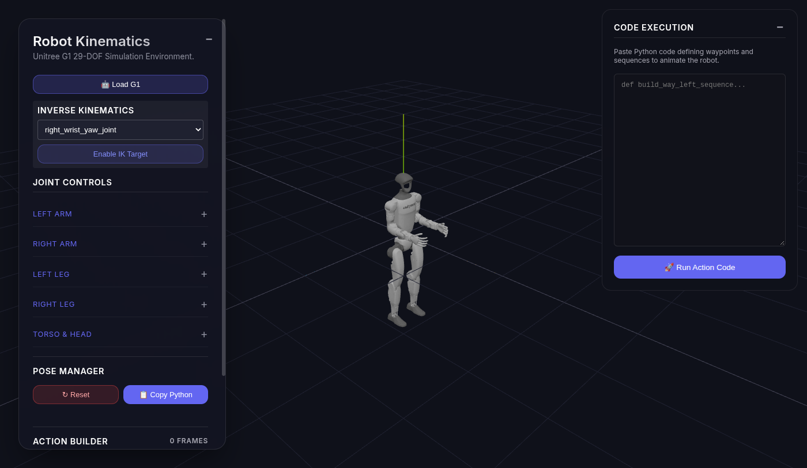

# Unitree G1 Robot Simulator

A browser-based 3D kinematics simulator for the Unitree G1 29-DOF humanoid.

**Live demo:** https://robotsimulator-1ce32.web.app/

## Run locally

This is a static site. `index.html` loads the app as an ES module and pulls Three.js and `urdf-loader` through an import map, so open it from a local HTTP server rather than `file://`.

```bash
python3 -m http.server 8080
```

Then visit http://localhost:8080/. No install or build step is required. The page also loads MediaPipe from a CDN for webcam pose detection.

## Features

- The G1 model loads on its own, with a Start demo fallback if that load fails
- First-visit tips (robot loaded, try a pose, copy Python), remembered in this browser after dismissal
- Joint controls for the loaded robot
- Pose library (T-pose, wave, walk-ready, sit, handshake, squat)
- Webcam pose
- Inverse kinematics target
- Python pose export (copy to clipboard)
- Share link for the current pose (`?pose=`). Action Builder frames are included when the link stays under about 2,000 characters
- Action builder (keyframes, playback, and Python export)

## Screenshot



Replace `docs/screenshot.png` by serving the site, loading the G1 model, and saving a capture of the full window to that path. A short GIF can live at `docs/demo.gif` and be linked the same way.

## Analytics

`analytics.js` records named events without a third-party account or API key. On localhost it prints them to the console as `[rs-analytics]`. On the hosted site those console logs stay off unless you set `localStorage.rs_analytics` to `1`.

To attach a backend later, set a hook before the app module runs:

```html
<script>
  window.__RS_ANALYTICS__ = (name, detail) => {
    // name: page_view | load_g1 | g1_autoload | preset_click | demo_preset | export_pose | webcam_start | onboarding_start | onboarding_dismiss | share_copy | share_load
  };
</script>
```

Events currently emitted: `page_view`, `load_g1`, `g1_autoload`, `preset_click`, `demo_preset`, `export_pose`, `webcam_start`, `onboarding_start`, `onboarding_dismiss`, `share_copy`, `share_load`.
